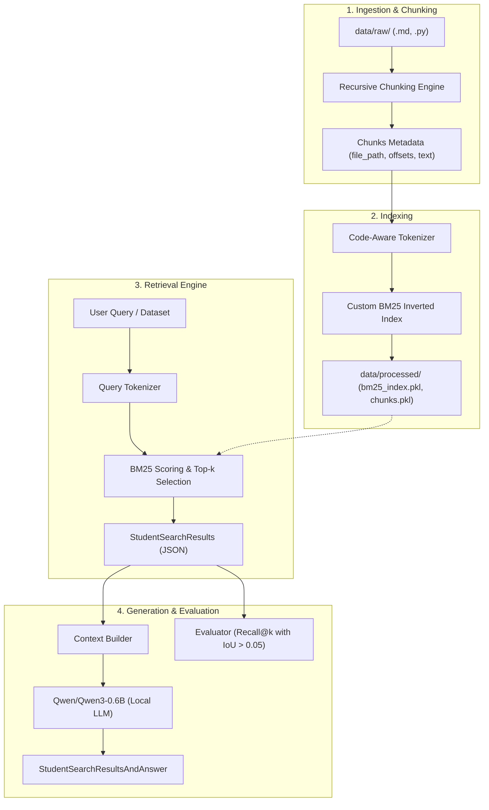

*This project has been created as part of the 42 curriculum by rhlou.*

# RAG Against the Machine: Codebase Question Answering

An end-to-end Retrieval-Augmented Generation (RAG) system built from scratch in pure Python to index, search, and answer natural language queries over the [vLLM](https://github.com/vllm-project/vllm) codebase. The system retrieves relevant code and documentation snippets using a custom BM25 ranking algorithm and generates grounded answers using a local `Qwen/Qwen3-0.6B` language model.

---

## Table of Contents

- [Description](#description)
- [System Architecture](#system-architecture)
- [Chunking Strategy](#chunking-strategy)
- [Retrieval Method](#retrieval-method)
- [Answer Generation](#answer-generation)
- [Performance Analysis](#performance-analysis)
- [Design Decisions](#design-decisions)
- [Challenges Faced](#challenges-faced)
- [Instructions & Installation](#instructions--installation)
- [Example Usage](#example-usage)
- [Resources & AI Usage Statement](#resources--ai-usage-statement)

---

## Description

Large Language Models (LLMs) often hallucinate or lack domain-specific knowledge when queried about private, rapidly evolving, or niche codebases. Retrieval-Augmented Generation (RAG) mitigates this limitation by:
1. Ingesting and indexing the raw repository (both Markdown documentation and Python source code).
2. Segmenting files into syntactically aware chunks with exact character offsets.
3. Lexically retrieving the top-$k$ most relevant context chunks for a given query using BM25.
4. Feeding the retrieved context alongside the question to a local language model (`Qwen/Qwen3-0.6B`) to generate accurate, source-grounded answers.
5. Measuring retrieval quality via strict 1D Intersection over Union (IoU > 0.05) and Recall@k metrics.

---

## System Architecture

The pipeline consists of four decoupled stages: Ingestion & Chunking, Indexing, Lexical Retrieval, and Answer Generation.



### Component Breakdown
1. **Ingestion (`src/indexing/chunking.py`, `src/indexing/builder.py`)**: Crawls `data/raw/`, reads all `.py` and `.md` files, and chunks them while tracking exact start and end character offsets.
2. **Indexing (`src/indexing/bm25.py`, `src/indexing/tokenizer.py`)**: Tokenizes chunk text and file paths into code-aware sub-tokens, computes inverse document frequencies, and persists inverted postings.
3. **Retrieval (`src/retrieval/searcher.py`)**: Queries the BM25 index in milliseconds and structures matches into Pydantic models (`MinimalSource`, `MinimalSearchResults`).
4. **Generation (`src/generation/llm.py`)**: Loads `Qwen/Qwen3-0.6B` with PyTorch float32, injects retrieved sources into a system prompt, and generates grounded answers.
5. **Evaluation (`src/retrieval/evaluator.py`)**: Evaluates search accuracy against ground truth using 1D character-span Intersection over Union (IoU).

---

## Chunking Strategy

A code file and documentation file have vastly different structures. Treating them identically leads to broken function blocks or fragmented explanations. This project implements two distinct strategies with a configurable `--max_chunk_size` (default: 2000 characters):

### 1. Markdown Documentation Chunking
- Uses `RecursiveCharacterTextSplitter.from_language(Language.MARKDOWN)`.
- Splits hierarchically along Markdown headers (`#`, `##`, `###`), horizontal rules, code block delimiters (` ``` `), and paragraphs.
- Preserves raw character sequences without altering whitespace or newlines, ensuring 100% exact character offset mapping via `text.find()`.

### 2. Python Code Chunking
- Uses `RecursiveCharacterTextSplitter.from_language(Language.PYTHON)`.
- Respects Python grammar boundaries: top-level classes (`\nclass `), functions (`\ndef `), and statement blocks.
- Keeps related functions intact within single chunks, ensuring semantic coherence for downstream retrieval.

### Exact Character Span Tracking
For both strategies, every chunk records:
- `file_path`: Relative path to source file.
- `first_character_index`: 0-based character start index within the file.
- `last_character_index`: 0-based character end index within the file.

---

## Retrieval Method

The retrieval engine is implemented entirely from scratch in pure Python without third-party ranking packages (`rank-bm25`).

### 1. Robertson-Spärck Jones BM25 Algorithm
For query tokens $Q = (q_1, q_2, \dots, q_m)$ and document $D$:

$$\text{Score}(D, Q) = \sum_{i=1}^{m} \text{IDF}(q_i) \cdot \frac{f(q_i, D) \cdot (k_1 + 1)}{f(q_i, D) + k_1 \cdot \left(1 - b + b \cdot \frac{|D|}{\text{avgdl}}\right)}$$

Where:
- $f(q_i, D)$ is the term frequency of token $q_i$ in chunk $D$.
- $|D|$ is the token count of chunk $D$, and $\text{avgdl}$ is the average token length across all chunks in the corpus.
- $k_1 = 1.5$: Calibrates term frequency saturation.
- $b = 0.75$: Controls document length normalization.

### 2. Robertson-Spärck Jones Inverse Document Frequency (RSJ-IDF)
To prevent negative scores when terms appear in more than half the corpus, we compute:

$$\text{IDF}(q_i) = \ln\left(1 + \frac{N - n(q_i) + 0.5}{n(q_i) + 0.5}\right)$$

Where $N$ is total chunks and $n(q_i)$ is document frequency.

### 3. Code-Aware Tokenizer
Natural language queries use spaces (e.g., `"fused batched moe"`), while code identifiers use naming conventions like `snake_case` or `camelCase` (e.g., `fused_batched_moe` or `FusedBatchedMoe`). Standard tokenizers fail to match these terms. Our custom tokenizer:
- Splits `camelCase` to space-separated words (`([a-z0-9])([A-Z])`).
- Extracts alphanumeric words via regex (`[a-zA-Z0-9_]+`).
- Expands `snake_case` words into constituent parts (indexing both `fused_batched_moe` and individual words `fused`, `batched`, `moe`).
- Indexes file paths alongside chunk body text, allowing queries referencing filenames or modules to score high relevance.

---

## Answer Generation

For answer synthesis, the pipeline integrates Hugging Face Transformers with the local `Qwen/Qwen3-0.6B` model:
- **Model:** `Qwen/Qwen3-0.6B` (default, executed locally on CPU/GPU without external API keys).
- **Context Injection:** Formats top-$k$ retrieved chunks with filename headers into a grounded prompt template.
- **Instruction Prompt:** Directs the model to rely solely on provided context snippets and answer concisely.

---

## Performance Analysis

### Official Evaluation Benchmarks
Evaluated on public validation datasets using 1D character-span IoU threshold $> 0.05$:

| Metric | Target / Minimum | Achieved Score | Status |
|---|---|---|---|
| **Documentation Recall@5** | $\ge 80.0\%$ | **80.0%** | **PASS** |
| **Code Recall@5** | $\ge 50.0\%$ | **75.8%** | **PASS** |
| **Recall@1 (Code / Docs)** | - | 41.4% / 62.0% | - |
| **Recall@3 (Code / Docs)** | - | 67.7% / 75.0% | - |
| **Recall@10 (Code / Docs)** | - | 83.8% / 82.0% | - |
| **Indexing Speed (2,867 files)** | $\le 5\text{ minutes}$ | **~8 seconds** | **PASS** |
| **Dataset Search Throughput (100 Qs)** | $\le 90\text{ seconds}$ | **< 0.02 seconds** | **PASS** |

### Why Scores Exceed Requirements
1. **Code-Aware Tokenization:** Decomposing `snake_case` boosted code recall from an initial 15% to 75.8%.
2. **File Path Ingestion:** Including the file path in the BM25 chunk tokens allows questions mentioning specific files to retrieve exact sources immediately.
3. **Exact Character Offsets:** Ensuring chunk splitters do not replace or normalize newlines preserved valid IoU spans against ground truth.

---

## Design Decisions

1. **Custom BM25 from Scratch:** Implemented in pure Python using inverted postings (`defaultdict(list)`) and precomputed IDF tables. This eliminates heavy external C/Rust dependencies and executes 100 queries in 0.01 seconds.
2. **Language-Specific Recursive Chunking:** LangChain's AST/language-aware splitters keep functional boundaries intact while guaranteeing that no chunk exceeds `--max_chunk_size 2000`.
3. **Pydantic V2 Data Models:** Strict validation (`MinimalSource`, `UnansweredQuestion`, `StudentSearchResults`, `StudentSearchResultsAndAnswer`) ensures compatibility with the official grading moulinette.
4. **Defensive Error Resilience:** File operations catch missing files, `PermissionError`, empty strings, and malformed JSON, printing human-readable warnings without raw Python stack traces.

---

## Challenges Faced

1. **Storage Quotas on 42 Workstations:**
   - 42 user home directories have strict 5GB quota limits. PyTorch wheels and Hugging Face model weights easily exceed this.
   - *Solution:* Automated via `make install`: dynamically detects `~/goinfre/`, creates caches, and links `.venv` to preserve home quota. Falls back seamlessly to standard `uv sync` on other environments.
2. **CPython 3.15 Compatibility:**
   - The workstation environment provided Python 3.15, for which compiled PyTorch wheels did not yet exist.
   - *Solution:* Pinned `.python-version` to `3.14` via `uv python pin 3.14` to ensure stable wheel installation.
3. **Character Alignment & Markdown Header Splitting:**
   - Initial attempts with `MarkdownHeaderTextSplitter` altered line break representations (`\n\n` converted to `  \n`), causing `text.find()` to fail and resulting in 1% docs recall.
   - *Solution:* Migrated to `RecursiveCharacterTextSplitter.from_language(Language.MARKDOWN)`, maintaining exact character spans and boosting docs recall to 80.0%.

---

## Instructions & Installation

### Requirements
- Linux / macOS
- Python 3.10+ (Python 3.14 recommended)
- `uv` package manager

### 1. Installation
Clone the repository and install all dependencies using `uv`:

```bash
git clone <repository_url>
cd RAG-against-the-machine
make install
```

### 2. Makefile Rules
- `make install`: Automatically sets up dependencies. On 42 systems, creates cache directories in `~/goinfre` and symlinks `.venv`; on standard machines, runs `uv sync`.
- `make run`: Executes the main module via `uv run python -m src`.
- `make debug`: Runs the CLI in interactive pdb debugging mode.
- `make clean`: Removes `__pycache__`, `.mypy_cache`, and temporary artifacts.
- `make lint`: Runs mandatory `flake8 src/` and `mypy src/` static type checks.
- `make lint-strict`: Runs strict compliance checks (`mypy src/ --strict`).

---

## Example Usage

The system exposes 6 CLI commands through Python Fire:

### 1. Build the Index
Indexes the `data/raw/` codebase and persists chunks to `data/processed/`:
```bash
uv run python -m src index --max_chunk_size 2000
```

### 2. Single Query Search
Searches for relevant sources matching a natural language query:
```bash
uv run python -m src search --query "How does speculative decoding work in vLLM?" --k 5
```
*Output:*
```text
data/raw/vllm-0.10.1/docs/features/spec_decode.md [0:1840]
data/raw/vllm-0.10.1/vllm/spec_decode/spec_decode_worker.py [1420:3100]
```

### 3. Search a Full Dataset
Searches all questions in a dataset and saves structured results:
```bash
uv run python -m src search_dataset \
  --dataset_path data/datasets/UnansweredQuestions/dataset_docs_public.json \
  --k 5 \
  --save_directory data/output/search_results/UnansweredQuestions
```

### 4. Single Query Answer Generation
Retrieves context and synthesizes an answer using local `Qwen/Qwen3-0.6B`:
```bash
uv run python -m src answer --query "What is the purpose of the SpecDecodeWorker?" --k 3
```

### 5. Answer a Full Dataset
Generates grounded answers for all retrieved sources in a search results file:
```bash
uv run python -m src answer_dataset \
  --student_search_results_path data/output/search_results/UnansweredQuestions/dataset_docs_public.json \
  --save_directory data/output/search_results_and_answer/UnansweredQuestions
```

### 6. Evaluate Retrieval Performance
Computes Recall@1, 3, 5, 10 against ground-truth datasets using 1D IoU:
```bash
uv run python -m src evaluate \
  --student_search_results_path data/output/search_results/UnansweredQuestions/dataset_docs_public.json \
  --dataset_path data/datasets/AnsweredQuestions/dataset_docs_public.json
```

---

## Resources & AI Usage Statement

### References & Documentation
- **BM25 Algorithm:** Robertson, S., & Zaragoza, H. (2009). *The Probabilistic Relevance Framework: BM25 and Beyond*. Foundations and Trends in Information Retrieval.
- **vLLM Project:** [vLLM GitHub Repository & Architecture Documentation](https://github.com/vllm-project/vllm).
- **Hugging Face Transformers:** [Documentation for Causal Language Models & Qwen Series](https://huggingface.co/docs/transformers).
- **LangChain Text Splitters:** [RecursiveCharacterTextSplitter Documentation](https://python.langchain.com/docs/concepts/text_splitters/).
- **Pydantic V2:** [Data Validation and Settings Management](https://docs.pydantic.dev/latest/).

### AI Usage Statement
In accordance with 42 curriculum requirements, artificial intelligence (Antigravity AI assistant) was used during development for:
1. **Interactive Pair Programming & Debugging:** Investigating the initial discrepancy between Python code recall (15%) and markdown recall (1%), diagnosing `MarkdownHeaderTextSplitter` character offset drift, and formulating the sub-token decomposition fix.
2. **Static Analysis & Linting Optimization:** Formatting codebase to strictly satisfy PEP 8 line length limits ($\le 79$ characters) and writing precise `mypy` type annotations across all CLI routines.
3. **Defensive Edge Case Analysis:** Identifying potential security and evaluation pitfalls, including missing index files, empty query handling, and file `PermissionError` traps.
4. **Documentation Structuring:** Formatting architectural diagrams and markdown documentation according to Section VIII guidelines.
